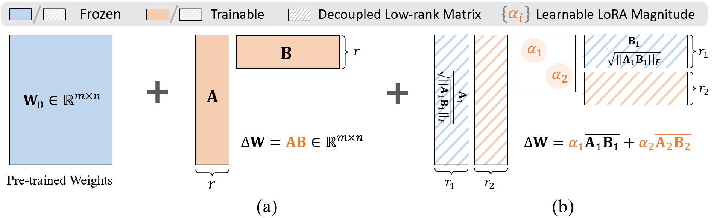
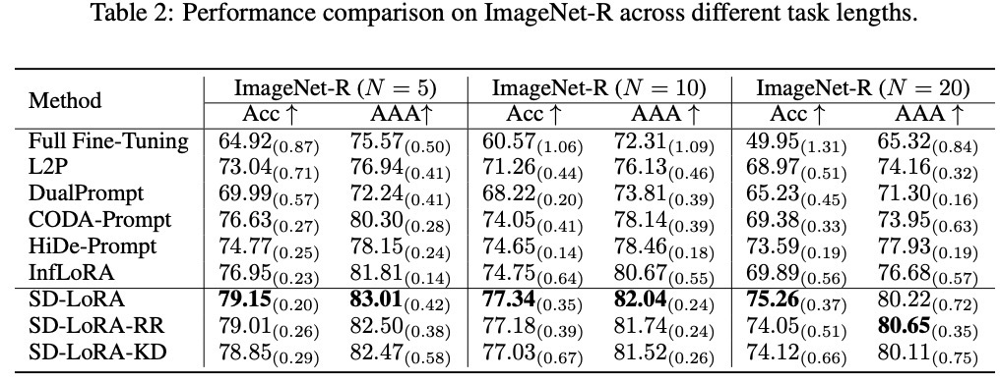
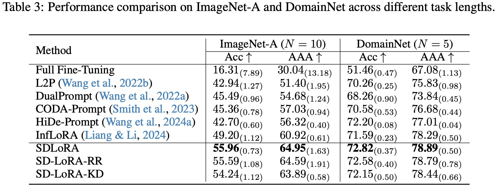

# SD-LoRA-CL Adaptive-A 研究仓库

基于 SD-LoRA 的类增量学习研究，包含固定 LoRA 状态、Live-A / Frozen-A
对照、HOEP-A 历史算子能量分区，以及任务边界诊断。

## 当前研究入口

- [最新实验结果：三数据集完整诊断与 HOEP 10 seed 进度](reports/experiment_results_20261010_0912.md)
- [HOEP 10 seed 扩展与实验恢复记录](reports/hoep_10seed_resume_20261009.md)
- [HOEP-A 方法设计与公式](reports/hoep_adaptive_a_method_design_20261009.md)
- [Adaptive-A 三数据集结果核查](reports/adaptive_a_proximity_20261008.md)
- [Live-A / Frozen-A 三 seed 进度与协议](reports/cuda6_live_frozen_progress_20261009_1146.md)
- [CIFAR 方向选择消融运行记录](reports/hoep_cifar15_stable_restart_20261009.md)

默认分支 `codex/live-frozen-stage-diagnostic` 包含边界诊断和上述研究文档。
[HOEP CIFAR 消融分支](https://github.com/hongshan123/SD-Lora-CL-adaptive-a/tree/codex/hoep-cifar-ablation-20261008)
包含 low/random/high/all 方向控制、对应测试以及避开不稳定 GPU 的调度代码。
两个分支对应不同实验版本；报告中的训练协议、完成状态和适用范围应分别引用。

## 上游 SD-LoRA

This research repository extends [SD-LoRA: Scalable Decoupled Low-Rank Adaptation for Class Incremental Learning **(ICLR 2025, Oral)**](https://openreview.net/pdf?id=5U1rlpX68A). The upstream citation and introduction are retained below.

If you find this code useful in your research then please cite  
```bibtex
@inproceedings{
wu2025sdlora,
title={{SD}-Lo{RA}: Scalable Decoupled Low-Rank Adaptation for Class Incremental Learning},
author={Yichen Wu and Hongming Piao and Long-Kai Huang and Renzhen Wang and Wanhua Li and Hanspeter Pfister and Deyu Meng and Kede Ma and Ying Wei},
booktitle={The Thirteenth International Conference on Learning Representations},
year={2025},
url={https://openreview.net/forum?id=5U1rlpX68A}
}
``` 

## 👀 Introduction


- SD-LoRA introduces a decoupled learning strategy for the magnitude and direction of LoRA components to achieve scalable continual learning without rehearsal of huge sample features.
- It demonstrates a strong stability-plasticity trade-off by converging to overlapping low-loss regions across sequential tasks, supported by empirical and theoretical analysis.
- SD-LoRA and its two variants enable end-to-end optimization and efficient inference without component selection, achieving state-of-the-art performance on multiple CL benchmarks and foundation models.

## 📜 Results


- To run the experiments, download the datasets to /data/ and execute:
   ```bash
  bash run.sh
   ```
- For your convenience, we have provided the running logs in the log file, where you can find detailed performance results for all streaming tasks.


## 🙏 Acknowledgement
This repo is built upon the following projects:

* [LoRA-ViT](https://github.com/JamesQFreeman/LoRA-ViT)
* [PILOT](https://github.com/sun-hailong/LAMDA-PILOT)
